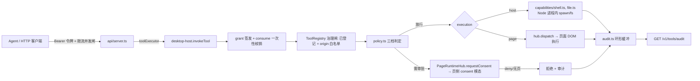

## 产品概述
把 deepseek-studio 桌面宿主从 v0.4 MVP 推进到 v0.5：在保持「加载真实 DeepSeek 聊天页 + 注入宿主 + 同意闸门」现有体验不变的前提下，完成安全石化、补齐审计，并新增 shell / 文件能力，让外部 agent 经本机 HTTP API（8756）能真正、可控地使用命令行与文件系统。

## 核心特性
1. **安全石化五项（路线图 v0.5）**：宿主令牌轮换（含旧令牌宽限期）、per-token 限流 + 并发上限（默认串行）、队列可观测（深度/等待时长/最近执行）、页面完整性探测（检测 `__deepseekStudio` 被篡改并降级）、CORS 严格化（仅 localhost/127.0.0.1，fail-closed）。
2. **审计闭环（还清 v0.3 遗留 3.2.4）**：工具执行全链路（签发→闸门→同意→执行→结果）留痕到进程内环形缓冲，并经 HTTP 端点可读。
3. **Shell / 文件能力**：在常驻 Node 宿主进程内执行，**绝不经过页面 DOM**；命令以 argv 方式执行（禁用 shell 解释器），带超时、输出截断、工作目录约束。
4. **三档命令审批模式**（用户选定口径）：
   - `ask`（默认，询问审批）：工作区间内的文件操作自动放行，其余一律弹窗审批；
   - `auto`（自动审批）：仅当检测到风险时才询问；
   - `full`（完全访问）：不询问。
   工作区间根目录可配置（环境变量优先，其次 `~/.config/deepseek-studio/config.json`），越界访问必须审批/拦截。

## 边界与硬约束
- 保持三条硬不变量：授权先于执行、grant 一次性消费、capability 显式 start/stop；fail-closed 优先。
- 端口固定 8756；不改动 `deepseek-pp/src/core/**`。
- 本轮不含 MCP stdio（v0.8 的 8.1）、不含真实 official-api（现为 fake）。
- 每步守住质量门：`npx vitest run` 全绿（基线 62/62）、`npx tsc --noEmit` 0 错误，`curl http://127.0.0.1:8756/healthz` 返回 `{"ok":true}`。


## 技术栈选型
沿用现有工程栈，不引入运行时新依赖（避免增大 esbuild 单文件产物与审计面）：

- 语言/构建：TypeScript strict、esbuild（`esbuild.inject.mjs` 打包 `src/desktop/entry.ts` → `src-tauri/inject/entry.js`）
- 宿主运行时：Node HTTP + `ws`（已在用，`src/host/page-runtime.ts`）
- 测试：`vitest`（`tests/desktop`、`tests/e2e`）
- 进程执行：Node `child_process.spawn`（**关键：`shell: false`，传 argv 数组**），`fs/promises` 做路径解析与 `realpath`
- 加密：`crypto.subtle`（`src/host/host-token.ts` 已在用 Web Crypto）

## 实现策略

### 1. 宿主侧执行 vs 页端执行（最关键的架构改动）
现状 `desktop-host.ts:179` 的 `routeExecution` 是「有页连接就优先派发到页面 DOM」，而 `chat-*` 依赖这条路径。**shell/file 绝不可走此路径**，否则页面脚本将获得进程执行能力。

方案：在 `ToolDefinition` 增加 `execution: 'page' | 'host'` 字段（默认 `'page'` 保持向后兼容），`routeExecution` 首行判定 `execution === 'host'` 时直接在宿主调用 capability，完全跳过 `hub.dispatch`。同时保留「宿主能力也必须过 grant consume + registry 治理」两层前置闸门。

### 2. 三档策略判定引擎（独立模块，便于单测）
新建 `src/host/policy.ts`，输入「工具 + 参数 + 解析后的目标路径 + 工作区根」输出决策：

| 档位 | 文件访问（工作区内） | 文件访问（工作区外） | shell 命令（无风险命中） | shell 命令（风险命中） |
|------|------------------|------------------|----------------------|---------------------|
| `ask` | 放行 | 审批 | 审批 | 审批 |
| `auto` | 放行 | 审批 | 放行 | 审批 |
| `full` | 放行 | 放行 | 放行 | 放行 |

- **风险模式**（硬编码常量，可配置扩展）：删除/格式化类（`rm -rf`、`del`、`format`、`rmdir /s`）、提权（`sudo`、`runas`）、磁盘写入设备、curl/wget 管道到解释器、`git push --force`、写入敏感目录（系统盘根、`~/.ssh`、凭据目录）。
- **工作区包含关系**：`path.relative(root, target)` 不以 `..` 开头且非绝对路径逃逸，且必须先 `fs.realpath()` 解析符号链接（防软链越狱）。
- 工作区根解析优先级：`STUDIO_WORKSPACE_ROOT` 环境变量 → `~/.config/deepseek-studio/config.json` 的 `workspaceRoot` → 拒绝启用 file 能力（fail-closed，避免隐式落到某个随意目录）。

### 3. 工具风险分级扩展
`ToolRisk` 现为 `'read' | 'insert' | 'send'`（`tool-registry.ts:13`），shell/file 需要更高危等级。扩展为新增 `'privileged'`（rank 4），同步 `RISK_ORDER` 与消费方（`desktop-host.ts:163` 的同意判定、既有测试）。（此步先用 [subagent:code-explorer] 枚举全部消费点，避免漏改。）

### 4. 审计贯穿全链路
新建 `src/host/audit.ts`：`ToolExecutionRecord`（工具名、风险、调用方 origin、grantId、决策来源档位、耗时、结果、涉及路径/命令摘要）写入有界环形缓冲。
埋点必须覆盖**所有终态**：`malformed` / grant 校验失败 / `unknown-capability` / `origin-denied` / `consent-denied` / `policy-denied` / 执行成功 / 执行失败。这是后续所有高风险能力的地基，先于安全件实现。

### 5. 无页连接时的行为定义（明确答复现有 fail-closed 冲突）
`ensureConsent`（`desktop-host.ts:171`）当前 `if (!hub) return false`。保持不变量，但按档位区分：
- `ask` 档需要审批的操作 → 无页 **拒绝**（`consent-unavailable`），因为无法征求人类同意；
- `auto` 档判定为无风险、且策略放行的操作 → 无页也可执行；
- `full` 档 → 无页直接执行。
这样既不破坏 fail-closed，又让 shell 在窗口关闭时仍可在受控档位下工作。

### 6. 安全件（5.1–5.5）要点
- **令牌轮换**：token 来源目前是构造期一次性字符串（`server.ts:44`），是轮换的直接阻碍 → 改为「令牌环」：当前令牌 + 旧令牌（宽限期），`Authenticator` 接受取令牌的函数而非字面量；`PlatformDesktop` 需支持双 secret 校验，保证轮换期已签发 grant 不被误拒。**默认不自动轮换**（`rotateIntervalMs=0`），提供 `rotate()` 与受保护的管理端点，避免自动轮换把外部客户端打掉。
- **限流并发**：修复现有计数缺陷（异常路径可能内外层重复 `active -= 1`），统一在单一 `finally` 归零；令牌桶 per-token + 并发上限（默认 1，串行），超限返回 429 并带 `Retry-After`。
- **队列可观测**：扩展 `QueueStatus`（保留 `queued`/`active` 字段做兼容），增加深度、平均等待、最近执行列表。
- **完整性探测**：新建 `src/desktop/integrity.ts`，周期性校验 `window.__deepseekStudio` 及其关键成员是否仍是宿主注入时的同一引用；异常则通过 ws 上报宿主，宿主把该页标记为不可信并停止向其派发工具（fail-closed 降级）。
- **CORS**：仅对 `Origin` 为 localhost/127.0.0.1/[::1] 的请求回 `Access-Control-Allow-Origin`，其余**不回该头**（fail-closed）；正确处理 OPTIONS 预检。

## 架构设计



## 目录结构

```
e:/NAS/deepseek-studio/
├── src/
│   ├── host/
│   │   ├── policy.ts                 # [NEW] 三档策略引擎（ask/auto/full）+ 工作区包含判定 + 风险模式
│   │   ├── workspace.ts              # [NEW] 工作区根解析（env > config.json > fail-closed）+ realpath 越界守卫
│   │   ├── audit.ts                  # [NEW] ToolExecutionRecord 环形缓冲（3.2.4 债务）
│   │   ├── tool-registry.ts          # [MODIFY] ToolRisk 增 'privileged'、ToolDefinition 增 execution 字段
│   │   ├── tool-definitions.ts       # [MODIFY] 登记 shell.exec / file.read / file.write / file.list
│   │   ├── desktop-host.ts           # [MODIFY] 宿主侧执行分支、三档判定接线、全终态埋点、令牌环接入
│   │   ├── host-token.ts             # [MODIFY] rotate() + 令牌环（当前/旧 + 宽限期）
│   │   └── platform-desktop.ts       # [MODIFY] 双 secret 校验（轮换期 grant 不被误拒）
│   ├── api/
│   │   ├── server.ts                 # [MODIFY] CORS 严格化、限流并发、/v1/tools/audit、QueueStatus 扩展
│   │   ├── auth.ts                   # [MODIFY] 支持动态令牌源（当前 + 宽限旧令牌），常量时间比较
│   │   └── types.ts                  # [MODIFY] ApiConfig 增 rotate/policy/workspace 配置；QueueStatus 扩字段
│   ├── capabilities/
│   │   ├── shell.ts                  # [NEW] argv 方式 spawn，禁用 shell 解释器，超时 + 输出截断
│   │   └── file.ts                   # [NEW] 读/写/列目录，均经 workspace 包含校验
│   ├── ui/consent.ts                 # [MODIFY] 高危工具呈现完整命令/路径摘要 + 越界徽标
│   ├── desktop/
│   │   ├── integrity.ts              # [NEW] 页面完整性周期探测与被篡改上报（5.4）
│   │   ├── host-client.ts            # [MODIFY] 完整性告警上报通道
│   │   └── entry.ts                  # [MODIFY] 挂探测、冻结关键属性
│   └── host/protocol.ts              # [MODIFY] 增加 integrity-alert 消息类型（可选能力，向后兼容）
├── tests/
│   ├── desktop/policy.test.ts        # [NEW] 三档判定矩阵、工作区内外、符号链接越狱
│   ├── desktop/audit.test.ts         # [NEW] 环形缓冲容量、全终态覆盖
│   ├── desktop/capabilities-shell.test.ts # [NEW] argv 执行、超时、越界拒绝、注入串被当普通参数
│   ├── desktop/integrity.test.ts     # [NEW] 篡改检测与降级
│   └── desktop/api-security.test.ts  # [NEW] 429 限流、CORS fail-closed、令牌轮换宽限期
└── docs/
    └── 版本路线图.md                  # [MODIFY] v0.5 状态回填与 v0.7 迁移说明
```

## 实施注意（防回归）
- `chat-*` 能力仍走页端 DOM，`execution` 默认 `'page'`，不得因新增字段改变既有路由。
- `routeExecution` 的宿主分支必须放在 `hub.connectedPages.length > 0` 判断**之前**。
- 所有 shell 执行禁用 `shell: true`；即便 `full` 档也保持 `argv` 执行，避免命令注入成为「完全访问」的副产品。
- 限流/并发计数的加减必须收敛到单一 `finally`，修掉现有可能重复递减的缺陷。
- 令牌轮换默认关闭；不把轮换后的令牌自动写回磁盘令牌文件（不在无人知情时落盘凭据）。
- 审计缓冲必须设上限（建议 200 条）防内存无界增长；命令/路径摘要脱敏，不记录完整输出正文。
- 每个 Epic 结束单独跑 `npx tsc --noEmit` 与 `npx vitest run`，避免最后一次性排错。
- 验证脚本写到系统临时目录（如 `%TEMP%`）并在收尾删除，不在工作区留 `tmp_*` 文件。
- 本机 agent 的 `execute_command` 实际是 `cmd.exe`：复杂 PowerShell 逻辑须写成 `.ps1` 文件执行；延时用 `ping -n N 127.0.0.1 >nul`（`timeout` 会因输入重定向立即退出）。


## Agent Extensions
### SubAgent
- **code-explorer**
  - 用途：在扩展 `ToolRisk` 枚举与新增 `execution` 字段前，穷举全部消费点（`tool-registry.ts`、`desktop-host.ts:163`、`tool-definitions.ts`、`tests/desktop/*`），避免漏改静默破坏既有同意闸门。
  - 预期产出：完整的消费点清单（文件路径 + 行号），据此确定最小改动面并逐处验证。
