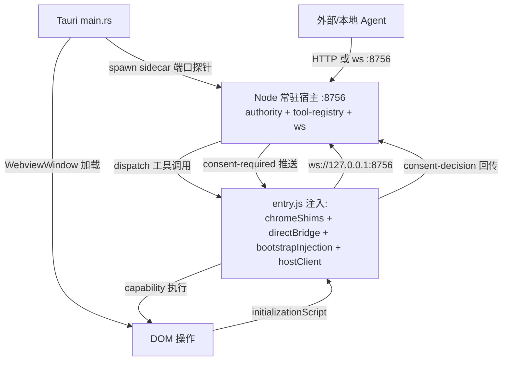

## 用户需求
在确保工程质量（fail-closed、typecheck 零错、vitest 全绿、同意闸门语义）的前提下，把 deepseek-studio 推进到 v0.4，交付第一个能日常使用的版本（MVP）。

## 产品概述
一个 Tauri 桌面壳应用：打开即加载真实 chat.deepseek.com 网页，通过注入脚本把"常驻宿主（本地 HTTP/ws 授权与工具执行服务）"与页面 DOM 能力桥接起来。外部或本地 Agent 经宿主发起工具调用，由用户在页面上点选同意或拒绝后，在真实对话页完成"读对话 / 插入文本 / 发送消息"。

## 核心功能
- 应用外壳：Tauri 窗口加载 chat.deepseek.com，document_start 注入编译后的 entry.js（含同域桥与注入加载器），并由主进程拉起 Node 常驻宿主（端口 8756），三者构成可运行闭环。
- 真实能力（v0.3.3）：chat-read（读取当前对话消息，低风险自动放行）、chat-insert（向输入框写入文本，中风险）、chat-send（发送消息，高风险，须用户同意）。均针对 chat.deepseek.com 真实 DOM 写选择器与特性探测，元素缺失返回结构化错误而非崩溃。
- 用户同意闸门（v0.3.2）：高风险/中风险工具调用在页面弹出非侵入式模态，展示工具名与脱敏参数，用户选"允许一次 / 拒绝 / 本次会话允许"；UI 缺失或超时按 fail-closed 默认拒绝。


## 技术栈
- 桌面壳：Tauri 2.x（Rust 主进程），WebView 加载外部 URL（chat.deepseek.com）。
- 注入层：TypeScript 经 esbuild 打包为单文件 IIFE（src-tauri/inject/entry.js），由 `initializationScript` 在 document_start 注入；无框架、无第三方 CDN。
- 常驻宿主：复用 v0.3.1 既有 Node 宿主（src/host/* + src/api/main.ts，端口 8756，HTTP+ws），零重写。
- 同意 UI：注入页内原生 HTML/CSS/TS 模态（轻量、单文件、明暗自适应）。
- 质量门：tsc --noEmit 零错、vitest run 全绿（保持 v0.3.1 基线 62/62）、公共边接口禁 `any`、无 `eval`/远程代码。

## 实现策略
- 主进程（main.rs）：用 `WebviewWindowBuilder` 设 `WebviewUrl::External(chat.deepseek.com)` 并通过 `.initialization_script()` 注入编译产物；在 `setup()` 中以 `async_runtime::spawn` 拉起宿主子进程，并加端口探针（8756 已监听则跳过，避免 dev 模式双起）。
- 注入页↔宿主连接：新增 page-side host ws 客户端（src/desktop/host-client.ts），在 entry.ts 装配后连接 `ws://127.0.0.1:8756`，承接 dispatch（工具执行）与 consent（同意推送/回传）两类消息；替换 loader.ts 中失效的 `deepseek-pp/.../lifecycle` 动态导入为本地 `src/inject/lifecycle.ts`（能力自注册或本地 content lifecycle）。
- 能力路由：宿主收到 dispatch 后，经 ws 推给注入页；页侧 host-client 按 `tool` 路由到对应 capability controller（chat-read/insert/send），执行结果回传宿主，再由宿主返回调用方。
- 同意流：authority.ask() 对 consent-allowlist 工具返回 `consent-required` 并挂起 grant；宿主通过 ws 向页推送 `{type:'consent-required', grantId, tool, params}`；页渲染模态，决策经 `{type:'consent-decision', grantId, decision}` 回传并 resolve grant；fail-closed（UI 缺失/超时→deny）。

## 实现要点（防回归）
- 复用现有 src/host/authority.ts 的 grant 状态机与 host-token 服务端拦截，仅扩展 consent 分支，不重写 allowlist 语义。
- 宿主 dispatch 链路沿用 v0.3.1 已验证的 ws→content script 路径；新增的 page host-client 必须与该协议同构（消息 type 枚举明确）。
- 构建管线：package.json 增 `build`（esbuild 打包 entry.ts→entry.js）与 `tauri:dev`/`tauri:build`（需补 @tauri-apps/cli）；tauri.conf.json 窗口改 External URL、移除对 devUrl 的强依赖（dev 下仍由 beforeDevCommand 起宿主）。
- 性能/健壮性：ws 连接断线指数退避重连；能力执行包 try/catch 返回结构化错误；同意模态超时默认 60s 后 deny。
- 日志：复用既有 console.warn/error 口径，注入脚本错误经 reportError 回传宿主，不静默吞。

## 架构设计


## 目录结构
```
deepseek-studio/
├── src-tauri/
│   ├── src/main.rs                 # [MODIFY] 窗口加载 chat.deepseek.com + 注入 entry.js + 拉起宿主 sidecar（端口探针防双起）
│   ├── tauri.conf.json             # [MODIFY] 窗口 WebviewUrl=External、initializationScript 改运行时注入、frontendDist 指构建产物
│   ├── capabilities/default.json  # [MODIFY/NEW] 放开 webview 加载外部 URL 与必要权限
│   └── inject/entry.js             # [NEW, 构建产物] esbuild 打包的注入 IIFE（不手写，由 build 生成）
├── package.json                    # [MODIFY] 增 build(esbuild)/tauri:dev/tauri:build，加 @tauri-apps/cli、esbuild
├── esbuild.inject.mjs              # [NEW] 注入脚本单文件打包配置（bundle+format=iife）
├── src/
│   ├── desktop/
│   │   ├── entry.ts                # [MODIFY] 装配新增 hostClient，挂 window.__deepseekStudio 含 host 连接态
│   │   └── host-client.ts          # [NEW] 页↔宿主 ws 客户端：dispatch 路由 + consent 推送/回传 + 重连
│   ├── inject/
│   │   ├── loader.ts               # [MODIFY] defaultLifecycleFactory 改引用本地 lifecycle，去除 deepseek-pp 动态导入
│   │   └── lifecycle.ts            # [NEW] 本地 content document lifecycle（能力自注册/回收），替代缺失的 deepseek-pp 模块
│   ├── capabilities/
│   │   ├── echo.ts                 # [保留] v0.3.1 基线能力
│   │   ├── chat-read.ts            # [NEW] 读取对话消息（DOM 选择器+特性探测+结构化错误），low 风险
│   │   ├── chat-insert.ts          # [NEW] 写入输入框文本，medium 风险
│   │   └── chat-send.ts            # [NEW] 发送消息，high 风险（必走同意）
│   ├── host/
│   │   ├── authority.ts            # [MODIFY] 新增 consent-required 分支与决策 resolve 通道（挂起/恢复 grant）
│   │   ├── desktop-host.ts         # [MODIFY] 将通过 ws 收到的页侧决策回灌 authority；向页推送 consent-required
│   │   └── tool-definitions.ts     # [MODIFY] 注册 chat-read/insert/send 并标 risk=low/medium/high
│   └── ui/
│       ├── consent.ts              # [NEW] 页侧同意模态：渲染工具名+脱敏参数+允许一次/拒绝/会话允许
│       └── consent.css             # [NEW] 模态样式（明暗自适应、非侵入、DeepSeek 蓝）
├── tests/                          # [NEW] chat-read/insert/send 单元 + authority 同意流 + host-client 协议 单测（vitest）
└── docs/
    ├── dev_plan.md                 # [MODIFY] v0.3.2/v0.3.3/v0.4 标记完成 + 自测清单
    └── 20-capability-architecture.md # [MODIFY] 标注 App Shell 实装与宿主运行位置
```

## 关键代码结构（节选）
```ts
// 宿主↔注入页消息协议（src/desktop/host-client.ts 与 src/host/desktop-host.ts 共用）
type HostMessage =
  | { type: 'dispatch'; callId: string; tool: string; params: unknown }
  | { type: 'consent-required'; grantId: string; tool: string; params: unknown }
  | { type: 'result'; callId: string; ok: boolean; data?: unknown; error?: string }
  | { type: 'consent-decision'; grantId: string; decision: 'allow-once' | 'deny' | 'allow-session' };

// 能力控制器接口（复用 src/inject/types.ts 的 ContentCapabilityController，新增页侧 host 路由签名）
interface ChatCapability {
  readonly id: 'chat-read' | 'chat-insert' | 'chat-send';
  execute(params: Record<string, unknown>): Promise<{ ok: boolean; data?: unknown; error?: string }>;
}
```


## 设计风格
面向已加载的 chat.deepseek.com 页面的"非侵入式授权浮层"设计。整体采用克制极简风：半透明遮罩 + 居中圆角卡片，配色沿用 DeepSeek 品牌蓝，明暗主题跟随系统/页面。模态不阻断页面阅读，仅在高危工具（chat-send）被调用时浮现，展示工具名与脱敏后的参数摘要，提供三个明确动作。动画仅保留 120ms 淡入与卡片轻微上浮，避免干扰主站体验。

## 页面构成
- 应用外壳窗口：无独立首页，启动即全屏加载 chat.deepseek.com；窗口标题栏极简，仅保留最小化/关闭。
- 同意模态（核心新 UI）：位于视口右下或居中，含图标、工具名、参数摘要行、三个按钮（允许一次 / 拒绝 / 本次会话允许）；超时进度条 60s 后自动归为"拒绝"。
- 宿主连接态指示（可选）：窗口角落极小的连接点（绿=已连 8756，灰=未连），不抢视线。

## 交互
- 模态出现时页面其余区域变暗但仍可滚动；点遮罩外不默认放行（防误触，需显式选择）。
- "允许一次"仅本次调用放行；"本次会话允许"在本会话内同工具免确认；"拒绝"终止该调用并回传 deny。
- 键盘可达：Esc=拒绝，Enter=允许一次；焦点自动落入主按钮。
