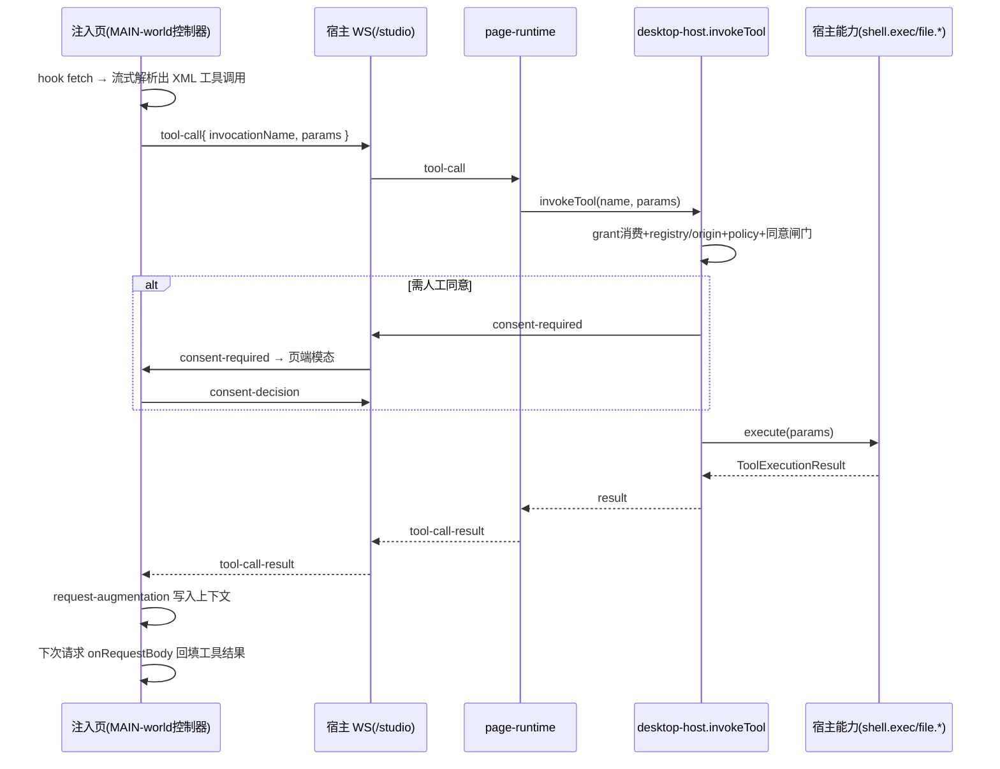

## 用户需求
推进 deepseek-studio 至 v0.6：把上游 deepseek-pp 的 MAIN-world 拦截器接入 Studio 注入管线，解析 DeepSeek 流式响应里的工具调用，经宿主执行真实工具并回注结果，跑通完整回路。

## 产品概述
在已交付 v0.5 五项安全件的基础上，v0.6 让 Studio 注入页能「看见」模型发起的工具调用（上游以 `<shell_exec>` / `<local_file_read>` 等 XML 调用标签形式流式返回），把调用转交常驻宿主真实执行（复用 v0.5 的 shell.exec / file.* 能力 + 完整授权链与同意闸门），再把执行结果回填到模型的下一次请求，使 DeepSeek 能基于工具结果继续推理。

## 核心特性
- **MAIN-world 拦截**：注入页在 document_start 钩住 fetch/XHR，用上游解析核心增量解析流式响应中的 XML 工具调用标签。
- **工具调用事件桥**：页端把解析出的 `{invocationName, params}` 经页↔宿主 WS 通道（`/studio`）以 `tool-call` 消息投递给宿主；宿主回 `tool-call-result`。
- **真实执行 + 授权复用**：宿主收到 `tool-call` 后走 `invokeTool` 完整授权链（grant 消费 → 工具登记/origin 闸门 → 策略档 → 同意闸门 → 宿主侧能力执行），shell.exec / file.* 真实运行。
- **契约对齐**：上游 XML 调用名（shell_exec / local_file_read / local_file_write / local_file_stat）映射为 Studio 工具 id（shell.exec / file.read / file.write / file.list），并适配参数结构。
- **结果回注**：宿主执行结果回到页端后，经上游 request-augmentation 写入请求上下文，由 `onRequestBody` 钩子回填到下一次对话请求体，模型据此续答。
- **同意闸门复用**：需人工同意的特权工具，宿主经既有 `consent-required` → 页端模态 → `consent-decision` 流程征求同意，无需新增 UI。


## 技术栈
- 沿用现有栈：TypeScript（strict）+ Tauri 桌面壳 + Node 常驻宿主 + 注入页（DOM 环境）。
- 上游 deepseek-pp 经 tsconfig 既有别名 `deepseek-pp/* → ./deepseek-pp/src/*` 导入（v0.6 红线：最大化 import 上游，不自研平行实现）。
- 注入构建走 `npm run build:inject`（产物 `src-tauri/inject/entry.js`）；需确保该 vite 构建同样能解析 `deepseek-pp` 别名。

## 实现方案
**策略**：在注入页新增一层「薄 MAIN-world 控制器」，import 上游 `fetch-hook`（`installFetchHook`）、`streaming-tool-call-parser`、`request-augmentation` 与 `hook-state`，通过 `updateHookState` 注册与上游 `main-world.content.ts` 一致的回调；但把上游的 `bridge.post` 换成「经宿主 WS 客户端投递 `tool-call`」。宿主侧扩展既有 `protocol.ts` 增加 `tool-call` / `tool-call-result` 消息，在 `page-runtime` 收到后调用既有 `host.invokeTool`（已含 grant 消费、registry/origin 闸门、policy 档、同意闸门、宿主侧能力执行），回写结果；页端收到结果后由 request-augmentation 回填下一次请求。

**关键技术决策**
1. **复用既有 WS 通道而非 direct-bridge**：direct-bridge 是页内 content↔injected 的可信通道；页→宿主通道是 `host-client` 的 WS `/studio`。`tool-call` 走 WS，避免新增传输层，也复用既有 hello/重连/超时语义。
2. **复用 `host.invokeTool` 而非另开执行入口**：它内部 `authority.requestToolExecution` 签发一次性 grant（origin=DEEPSEEK_ORIGIN，命中白名单），再经 `executeTool` 全闸门 + `hub.requestConsent`，与 v0.5 安全不变量完全一致，零新攻击面。
3. **契约映射层独立成模块**：上游 XML 调用名与 Studio 点分层级工具 id 不同（`shell_exec`→`shell.exec`，`local_file_read`→`file.read` 等），且参数形态（`{command,timeout_ms,cwd}`→shell.exec 的 argv/command）需适配，独立 `tool-contract.ts` 便于测试与演进。
4. **request-augmentation 原样复用**：上游已解决「把工具结果回填到下一次请求体」的复杂逻辑（按 route 隔离、仅回填对话请求），直接 import 而非重写，符合红线。

**性能与可靠性**
- 拦截为增量流式解析，仅对 chat.deepseek.com 请求生效；tool-call 事件低频，WS 往返开销可忽略。
- request-augmentation 按 route key 隔离，避免污染非对话请求（沿用上游 fail-closed 边界）。
- 全程 fail-closed：无可用页/超时/未登记工具/越界拒绝 → 调用失败且留痕（复用 v0.5 审计环）。

## 实现要点
- **耦合评估**：`streaming-tool-call-parser` 依赖 `../types`、`../tool/externalized-payload`、`../tool/execution-error`、`repair-tool-json`；`request-augmentation` 依赖 `request-context`。这些均为上游 core 纯逻辑模块，需确认不引入 WXT/chrome.* 硬依赖（用 [skill:lsp-code-analysis] 做依赖图影响分析）。若个别模块需浏览器 API（IndexedDB 历史拦截），仅按需启用 `hookFetch`+`hookXHR`，不强制挂 `hookIndexedDB`。
- **构建**：确认注入 vite 配置含 `deepseek-pp` 别名；`build:inject` 后 grep 产物确认解析代码已打包。
- **日志**：复用现有 `console.warn`/`reportError` 通道，tool-call 投递与结果回写记最小结构化日志，避免 dumping 大请求体。

## 架构设计


## 目录结构
```
src/inject/
├── main-world-interceptor.ts  # [NEW] 薄 MAIN-world 控制器。import 上游 installFetchHook/updateHookState/streaming-tool-call-parser/request-augmentation；注册 onToolCall/onToolCallStarted/onToolCallChunk/onResponseComplete/onRequestTerminal 回调；把 onToolCall 经 host-client WS 投递 tool-call，并把 tool-call-result 喂给 request-augmentation 上下文。document_start 挂载、含 stop() 清理。
├── tool-contract.ts           # [NEW] 契约映射层。上游 XML 调用名→Studio 工具 id 映射（shell_exec→shell.exec 等）+ 参数适配器；纯函数，便于单测。
├── loader.ts (或 lifecycle.ts) # [MODIFY] 注入启动处挂载 main-world-interceptor（与 installDirectBridge/bootstrapInjection 同源生命周期，确认精确挂载点后接线）。
└── index.ts                   # [MODIFY] 导出新增的 main-world-interceptor / tool-contract。

src/host/
├── protocol.ts                # [MODIFY] HostToPageMessage 增加 tool-call-result；PageToHostMessage 增加 tool-call{ callId, invocationName, params }。
└── page-runtime.ts            # [MODIFY] 在 ws 'message' 处理中新增 tool-call 分支：映射到 Studio 工具名→调用 host.invokeTool→回 tool-call-result；复用既有 consent 流程。

src/desktop/
└── host-client.ts             # [MODIFY] 新增 sendToolCall / 处理 tool-call-result（按 callId 关联，供 main-world-interceptor 异步取结果）；不破坏既有 dispatch/consent 处理。

[注入构建配置]
└── vite 注入配置 (vite.config.* 或 src-tauri/inject 构建)  # [MODIFY/核对] 确保 resolve.alias 含 deepseek-pp，使解析核心被打进注入产物。

tests/desktop/
└── tool-bridge.test.ts        # [NEW] 集成测试：mock 宿主 WS，验证 拦截→投递→授权→执行→回注 闭环；覆盖未登记工具/policy 拒绝/同意拒绝 的 fail-closed 路径。

docs/
├── 版本路线图.md              # [MODIFY] 回填 v0.6 完成状态与决策记录（含「最大化 import 上游」「真实执行」两项决策）。
```

## 关键代码结构（契约映射）
```ts
// src/inject/tool-contract.ts
export interface UpstreamToolCall {
  readonly invocationName: string;          // 如 'shell_exec' / 'local_file_read'
  readonly params: unknown;                 // XML 标签内解析出的对象
  readonly raw?: string;
}
/** 上游 XML 调用名 → Studio 已登记工具 id；返回 null 表示未登记（fail-closed）。 */
export function mapUpstreamTool(call: UpstreamToolCall): { id: string; params: Record<string, unknown> } | null;
```


## Agent Extensions
### Skill
- **lsp-code-analysis**
  - 用途：在实施前对上游 `streaming-tool-call-parser`、`request-augmentation`、`fetch-hook` 及其依赖（`../types`、`../tool/*`、`request-context`、`repair-tool-json`）做语义依赖图与引用分析，确认是否引入 WXT/chrome.* 硬依赖、评估打包耦合面。
  - 预期结果：输出一份依赖影响清单，标注可安全 import 的纯逻辑模块与需规避/打补丁的浏览器耦合点，指导薄控制器的最小 import 面，避免把上游 MV3 胶水带进注入产物。
