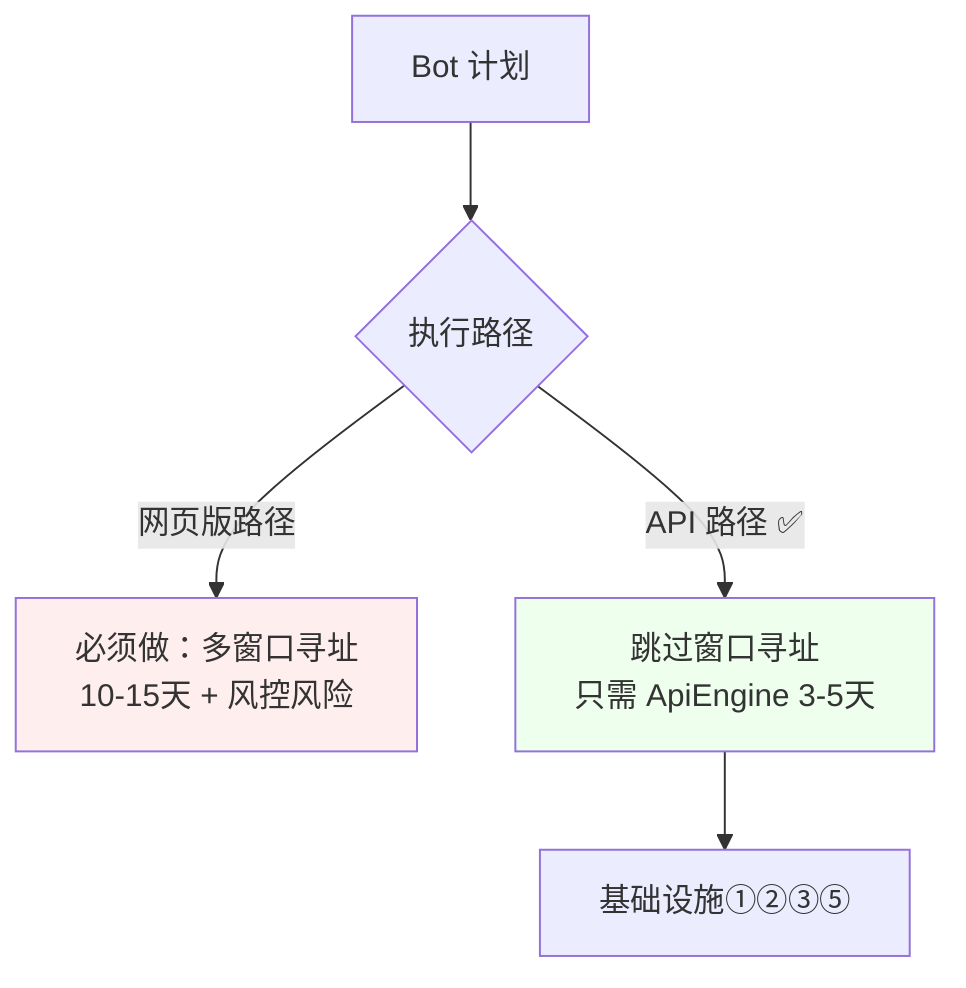

# 侦查报告：studio 地基承载力评估（Bot 计划前置）

> 日期：2026-10-14
> 方法：直接读 src/host 核心源码（web-engine / agent-loop / agent-channel / memory-store / skill-store / tool-registry / model-engine）
> 结论：**当前地基能支撑「单 Bot 增强」，但支撑不了「多 Bot 并行」。** 差距集中在三处硬约束。

---

## 0. 一句话结论

studio 的骨架是**为「单对话单 Agent」设计的**。Bot 计划需要的「N 个并行执行体 + 多账号窗口 + 治理级记忆」，当前三样都缺。**但——缺的不是架构，是「从 1 到 N」的实例化改造，量级可控。**

---

## 1. 源码级证据（硬约束）

### 硬约束 ① AgentLoop 是单例语义——同一时刻只允许一个活跃回合

```ts
// src/host/agent-loop.ts
async send(text: string): Promise<void> {
  if (active) throw new Error('agent-busy');   // ★ 单例锁
  active = true;
  ...
}
```

**影响**：5 个 Bot 并行 = 5 个并发 `send()`，当前实现直接抛 `agent-busy`。

**agent-channel 同样单例**：
```ts
readonly agent: { sendMessage; stop; running; health }  // ★ 单 agent
case 'send': if (options.host.agent.running) { ack(false, undefined, 'agent-busy'); }
```

### 硬约束 ② WebEngine 假设「一个页面」

```ts
// src/host/engine/web-engine.ts
async function readLastMessage() {
  const r = await options.dispatch('chat-read', {});   // ★ 读「那个」页面
  ...
}
```

`dispatch` 走 `desktop-host.invokeTool`，最终打到 **main 窗口的注入页**。整个链路假设「只有一个 DeepSeek 页面」。

**影响**：5 账号 = 5 个页面/窗口，当前没有「多窗口寻址」能力。

### 硬约束 ③ MemoryStore 是「扁平 JSON」，撑不起 Curator

```ts
// src/host/memory-store.ts
export type MemoryType = 'user' | 'project';       // ★ 只有两种类型，无账号/槽位/人设维度
private memories: Memory[] = [];                    // ★ 全量进内存
private persist(): void {                           // ★ 全量重写 JSON
  fs.writeFileSync(tmp, JSON.stringify(this.memories, null, 2), 'utf8');
}
```

**缺什么**（对照 Bot 计划需要）：
- ❌ 无向量检索（只 `list()` 全量返回 + `formatForPrompt` 全量注入）
- ❌ 无失效标记（无 `invalid_at`，无法「失效而非删除」）
- ❌ 无来源可信度（无 `source` / `confidence`，无法做冲突裁决）
- ❌ 无人设维度（无法按人设路由记忆子集）
- ❌ 无阈值/触发机制（无容量/时间/冲突阈值）
- ❌ 无全文检索（无 FTS）

**影响**：Curator 需要的「冲突消解/遗忘/路由/审计」一个都做不了。

### 硬约束 ④ ApiEngine 是 stub——从没实现

```ts
// src/host/engine/model-engine.ts
export function createApiEngineStub(): ModelEngine {
  return {
    name: 'api',
    async health() { return { ok: false, reason: 'api-engine-not-implemented (M3)' }; },
    async send() { throw new Error('api-engine-not-implemented (M3)'); },
  };
}
```

**影响**：Bot 用 API 的前提（绕开网页版风控）**根本不存在**。

---

## 2. 地基承载力评分表

| 能力 | 现状 | Bot 需要 | 差距 |
|---|---|---|---|
| **ModelEngine 抽象** | ✅ 双引擎接口已在 | 双引擎可指定 | **小**（接口够用，缺 ApiEngine 实现） |
| **AgentLoop 状态机** | ✅ 自包含 | N 个并发实例 | **中**（需去单例化，逻辑本身可复用） |
| **ToolRegistry 风险分级** | ✅ 完整 | 按人设过滤子集 | **小**（加 filter 即可） |
| **toolEventBus** | ✅ 完整 | 事件带 Bot 标签 | **小**（加 subagentId 字段） |
| **授权/同意链** | ✅ 完整 | 复用 | **无** |
| **多窗口/多账号寻址** | ❌ 单窗口假设 | N 窗口寻址 | **大**（Tauri 侧要改） |
| **并发执行体管理** | ❌ 单例锁 | N 并行 | **大**（核心改造） |
| **记忆层** | ❌ 扁平 JSON | 向量+失效+来源+路由 | **大**（几乎重写） |
| **ApiEngine** | ❌ stub | 真实现 | **大**（全新开发） |
| **人设/槽位/账号三层** | ❌ 无 | 完整三层 | **大**（全新） |
| **Curator 治理** | ❌ 无 | 异步治理 | **大**（全新） |

---

## 3. 启动 Bot 前必须迭代的基础设施（按依赖顺序）

### 基础设施 ①【必做】ApiEngine 真实现

**为什么最先**：它是「Bot 不封号」的前提（#13/#39）。没有它，多 Bot 只能挤网页版→必封。

**做什么**：
- 实现 `createApiEngine()`：调 DeepSeek 官方 API，原生 function calling
- 复用 `EngineSendResult` 接口（content + toolCalls）
- 支持并发（API 无多开概念）

**工作量**：3-5 天

### 基础设施 ②【必做】AgentLoop 去单例化 + Bot 实例化

**为什么**：当前 `if (active) throw 'agent-busy'` 是核心阻塞。

**做什么**：
- 把 `createAgentLoop` 从「全局单例」改为「工厂函数」（其实已是工厂，需去掉外层的单例装配假设）
- 引入 `BotInstance`：`{ loop, engine, persona, slotId }`
- `BotRegistry`：管理 N 个 `BotInstance` 的生命周期
- `agent-channel` 从「单 agent」改为「按 botId 路由」

**工作量**：5-7 天

### 基础设施 ③【必做】MemoryStore 升级为「记忆层 v2」

**为什么**：Curator 的地基。当前 JSON 撑不住。

**做什么**：
- 存储：SQLite（FTS5 全文）+ 向量索引（sqlite-vec）
- 字段：+ `source`（来源）+ `confidence`（可信度）+ `validAt`/`invalidAt`（失效标记）+ `personaTags`（人设维度）+ `contentHash`（去重）
- 接口：`search(query)` 混合检索；`invalidate(id)` 失效而非删除；`listByPersona(tag)` 路由
- 保留 `formatForPrompt` 兼容现有系统提示词注入

**工作量**：7-10 天

### 基础设施 ④【PoC 需要】多账号窗口寻址（可选 API 路径可绕过）

**为什么**：如果用 ApiEngine 跑 Bot，**这个可以推迟**——因为 API 不需要窗口。

**做什么**（仅网页版路径需要）：
- Tauri 侧：多 `WebviewWindow` 或一个窗口多 `WebContentsView`
- `dispatch(tool, params, { windowId })` 加寻址参数
- 账号 ↔ 窗口 绑定注册表

**工作量**：10-15 天（**能绕则绕**）

### 基础设施 ⑤【G1 前】Persona/Slot 注册表

**做什么**：
- `PersonaRegistry`：扫描 `personas/*/`（prompt + tools + memory 目录）
- `SlotRegistry`：槽位 ↔ 账号 ↔ 人设 三层绑定
- `Scheduler.assign()`：槽位分配

**工作量**：5-7 天

### 基础设施 ⑥【G2 后】Curator 治理服务

**做什么**：阈值触发的异步治理（#47）

**工作量**：15-20 天

---

## 4. 关键洞察：ApiEngine 是「地基捷径」



**如果 Bot 走 ApiEngine**（强烈推荐，见 #13/#39/#43）：
- ❌ 不需要多账号窗口（基础设施④）
- ❌ 不需要窗口前台化 / 冻结处理
- ❌ 不碰风控
- ✅ 并发天然成立

**这是最大的地基捷径**：`ApiEngine` 一实现，基础设施④整块消失。

---

## 5. 诚实结论

### 能支撑的
- 单 Bot 增强（现有 AgentLoop + WebEngine 已够）
- 工具调用 + 授权 + 事件流（完整）
- 引擎抽象（接口在，可扩展）

### 不能支撑的（必须迭代）
1. **并发执行体**（单例锁）—— 核心阻塞
2. **多账号窗口**（单窗口假设）—— 走 API 可绕过
3. **治理级记忆**（扁平 JSON）—— 几乎重写
4. **ApiEngine**（stub）—— 全新开发

### 启动 Bot 的**最小基础设施集**（走 API 路径）

| 序 | 设施 | 工期 | 是否阻塞 |
|---|---|---|---|
| 1 | ApiEngine 真实现 | 3-5 天 | ✅ 阻塞 |
| 2 | AgentLoop 去单例 + BotRegistry | 5-7 天 | ✅ 阻塞 |
| 3 | MemoryStore → 记忆层 v2 | 7-10 天 | ✅ 阻塞 Curator |
| 4 | Persona/Slot 注册表 | 5-7 天 | ✅ 阻塞 G1 |
| **合计** | | **20-29 天** | |

**加上 G1 的 PoC（24 天），从今天到 PoC 决策点约 44-53 天**（不含调试意外，实际 ×1.5）。

### 一句话

> **studio 的地基不是「撑不撑得起」的问题，而是「要先补 4 块基础设施、约 20-29 天」的问题。** 好消息是：**走 API 路径能砍掉最痛的「多窗口寻址」整块**，让地基改造量减半。坏消息是：记忆层 v2 是硬骨头，绕不过去。

---

## 6. 与已有讨论的呼应

| 本报告要点 | 来源 |
|---|---|
| ApiEngine 是前提，绕开风控 | #13 / #39 |
| AgentLoop 可复用但需去单例 | 本次读码 |
| 记忆层是 Curator 地基 | #46 / #47 |
| Persona/Slot 三层解耦 | #45 |
| 只回摘要 + 证据引用 | #40 / #45 |
| 记忆治理阈值触发 | #47 |
