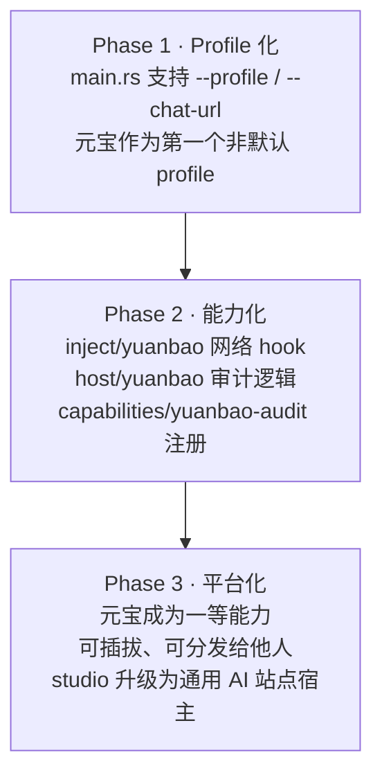

# 建议书：为「元宝审计插件」升级 deepseek-studio 架构

> 版本：v0.1 · 2026-10-12
> 对象：deepseek-studio 开发团队
> 归档：`docs/架构文档/`
> 关联：`architecture.md`、`architecture-review.md`、`v0.12-Phase1-sidecar监管层设计稿-MiMo-20261011.md`

---

## 0. 摘要（TL;DR）

我们有一个真实需求：**24 小时无人值守的元宝（yuanbao.tencent.com）网页版沙箱审计系统**。

现状是用「CDP 连外部浏览器 + DOM 脚本」实现，经过一周迭代打了 6 个补丁，仍不稳定：

| 补丁 | 症状 | 根因 |
|---|---|---|
| v3 | 第 1 轮就「完成」退出 | 提示词模板污染 `body.innerText` |
| v4.1 | 暂停后仍自动发「继续」 | `paused` 未门禁 stall 分支 |
| v4.2 | `对话 0 字`、找不到输入框 | 标签页后台被 Chrome 冻结 |
| v5.1 | 轮次判定漂移 | `textContent`/`innerText` 表示差异 |
| v5.3 | 需手写去重锁 | DOM 无「已消费」语义 |

**6 个补丁本身就是「架构层级不对」的信号**——我们一直在用「给人看的界面」当「给机器用的 API」。

**本建议书主张**：不要把元宝做成独立项目，也不要改 studio 核心，而是**把元宝作为 studio 的「第二个站点 profile」，以平行模块方式并入**。studio 现有架构已具备 90% 所需能力，缺的只是一个 profile 机制和一组 `yuanbao/` 模块。

**为什么值得做**：这不仅解决元宝需求，更能把 studio 从「DeepSeek 专用宿主」升级为**「通用 AI 站点宿主 / 自动化平台」**，打开产品想象空间。

---

## 1. 现状：studio 已是「宿主 + 能力」架构

读 `src/` 全树确认（2026-10-12 实勘）：

```
src/
├── capabilities/      ← 能力位（插件）
│   ├── chat-send.ts     (4387)   发送消息
│   ├── chat-read.ts     (2312)   读取对话
│   ├── chat-insert.ts   (1330)   插入内容
│   ├── dom.ts           (2623)   DOM 操作
│   ├── file.ts          (6905)   文件能力
│   ├── shell.ts         (10009)  Shell 能力
│   └── types.ts         (2362)   能力契约
├── host/              ← 宿主核心
│   ├── tool-registry.ts (5286)   ★ 工具/插件注册表
│   ├── tool-definitions.ts(7554) 工具定义
│   ├── mcp-controller.ts(26238)  MCP 协议控制
│   ├── skill-store.ts   (4266)   技能存储
│   ├── automation.ts    (12379)  自动化调度
│   ├── agent-loop.ts    (6583)   智能体主循环
│   ├── agent-channel.ts (6639)   智能体通信
│   ├── page-runtime.ts  (17239)  页面运行时
│   ├── desktop-host.ts  (44405)  桌面宿主
│   ├── policy.ts        (11400)  权限策略
│   ├── sandbox-executor.ts(4754) 沙箱执行
│   └── workspace.ts     (9448)   工作区
├── inject/            ← 注入层（document-start）
│   ├── loader.ts        (5183)   ★ 注入加载器
│   ├── lifecycle.ts     (2299)   ★ 注入生命周期
│   ├── origin-guard.ts  (608)    源校验
│   ├── main-world-interceptor.ts(40619) ★ 主世界拦截器
│   ├── sse-text-extractor.ts(6150)      ★ SSE 文本提取
│   ├── streaming-tool-parser.ts(4955)   流式工具解析
│   ├── tool-card-ui.ts  (13805)  工具卡片 UI
│   ├── step-flow-ui.ts  (18004)  步骤流 UI
│   └── pow.ts / pow-wasm.ts       PoW 反爬
├── bridge/            ← 桥接层
│   ├── envelope.ts / transport.ts / transport-webview.ts
│   ├── storage.ts       (14898)
│   └── runtime.ts       (4857)
├── shared/            ← 共享契约
│   ├── tool-contract.ts (6250)   工具契约
│   ├── tool-event-bus.ts(9158)   事件总线
│   ├── tool-hooks.ts    (10580)  工具钩子
│   └── tool-loop.ts / tool-record.ts
└── ui/                ← 面板
    ├── agent-panel.ts / studio-input-bar.ts / studio-mcp-dialog
    └── consent.ts
```

**结论**：

- `tool-registry.ts` **就是**插件注册表
- `capabilities/` **就是**能力/插件位
- `inject/loader.ts` + `lifecycle.ts` **就是**注入管理
- `bridge/` + `shared/tool-contract.ts` **就是**插件与宿主的通信契约

**studio 早已是我们想要的「插件架构」。** 元宝不需要「先独立后收编」，它从第一天就可以作为 studio 的一个模块存在。

---

## 2. 为什么否决另外两条路

### 2.1 纯独立项目 ❌

要重造 studio 已有的：

| 需重造 | studio 已有 |
|---|---|
| 浏览器宿主 | Tauri 2 + WebView2 + `main.rs` |
| document-start 注入 | `initialization_script` + `inject/loader.ts` |
| 进程监管 | `sidecar.rs` (14454) + `SidecarHandle` |
| 插件注册 | `tool-registry.ts` + `capabilities/` |
| 通信契约 | `bridge/` + `tool-contract.ts` |
| 权限策略 | `host/policy.ts` |
| 沙箱执行 | `host/sandbox-executor.ts` |
| 系统托盘 / 自启 / 更新 | tauri-plugin-* |

**重造 90% 且永远拿不到 studio 的更新**，是纯浪费。

### 2.2 直接改 studio 核心 ❌

- 污染 DeepSeek 逻辑，`git pull` 时冲突爆炸
- 无法回滚，无法单独分发
- 违反「核心稳定、能力可插拔」的基本工程原则

**改核心是禁忌。**

### 2.3 先独立后并入 ⚠️

要经历一次痛苦迁移重写，且独立期的结构未必适配 studio。**不如一开始就按 studio 的结构长。**

---

## 3. 推荐方案：元宝 = studio 的第二个站点 profile

### 3.1 目标形态

```
deepseek-studio/
├── src/
│   ├── inject/
│   │   ├── main-world-interceptor.ts   (DeepSeek 的，不动)
│   │   ├── sse-text-extractor.ts       (DeepSeek 的，不动)
│   │   └── yuanbao/                    ★ 新增
│   │       ├── api-hook.ts             劫持 fetch/XHR/EventSource
│   │       ├── sse-parser.ts           解析元宝流式响应
│   │       └── index.ts
│   ├── host/
│   │   └── yuanbao/                    ★ 新增
│   │       ├── audit-loop.ts           审计主循环（原 watcher）
│   │       ├── round-tracker.ts        轮次/信号追踪
│   │       ├── site-profile.ts         站点画像（选择器/API 特征）
│   │       └── index.ts
│   ├── capabilities/
│   │   └── yuanbao-audit.ts            ★ 新增：能力注册
│   └── profiles/                        ★ 新增：站点画像目录
│       ├── deepseek.ts
│       └── yuanbao.ts
├── src-tauri/
│   └── src/main.rs                      △ 改一处：支持 --profile
└── docs/架构文档/
    └── 建议书-元宝插件架构升级-v0.1-20261012.md
```

**全部新增，零改动 DeepSeek 代码。**

### 3.2 三阶段落地



---

## 4. Phase 1 详细设计：Profile 机制（最小改动）

### 4.1 当前问题

`main.rs` 硬编码：

```rust
const CHAT_URL: &str = "https://chat.deepseek.com";
// ...
WebviewWindowBuilder::new(app, "main",
    WebviewUrl::External(Url::parse(CHAT_URL).expect("invalid chat url")))
    .initialization_script(&load_init_script())
```

### 4.2 改造目标

```rust
// 新增：站点画像
struct SiteProfile {
    key: &'static str,
    url: &'static str,
    inject_dir: &'static str,   // 注入脚本目录
    title: &'static str,
}

const PROFILES: &[SiteProfile] = &[
    SiteProfile {
        key: "deepseek",
        url: "https://chat.deepseek.com",
        inject_dir: "inject",
        title: "DeepSeek++ Studio",
    },
    SiteProfile {
        key: "yuanbao",
        url: "https://yuanbao.tencent.com/chat/",
        inject_dir: "inject/yuanbao",
        title: "元宝审计工作台",
    },
];

// 解析启动参数：--profile yuanbao / --chat-url <任意URL>
fn resolve_profile() -> &'static SiteProfile {
    let args: Vec<String> = std::env::args().collect();
    let key = args.iter().position(|a| a == "--profile")
        .and_then(|i| args.get(i + 1))
        .map(|s| s.as_str())
        .unwrap_or("deepseek");
    PROFILES.iter().find(|p| p.key == key).unwrap_or(&PROFILES[0])
}
```

### 4.3 兼容性保证

- **默认行为完全不变**：不传 `--profile` 就是 DeepSeek
- `STUDIO_DISABLE_INJECT` / `STUDIO_DISABLE_HOST` 开关保持不变
- 窗口状态记忆按 profile 分文件（`window-state-yuanbao.json`），避免尺寸互相覆盖
- 托盘标题随 profile 变化

### 4.4 Phase 1 验收标准

1. `cargo build` 通过
2. `deepseek-studio.exe`（无参数）行为与现在完全一致
3. `deepseek-studio.exe --profile yuanbao` 打开元宝页面
4. 配合 `STUDIO_DISABLE_INJECT=1`，能手动在元宝页发一条消息并看到回复
5. 窗口关闭后重开，位置尺寸被记住

**这一步只加不改，可回退，不影响现有 DeepSeek 使用。**

---

## 5. Phase 2 详细设计：网络层钩子

### 5.1 核心洞察

元宝是 Next.js + React SPA（实测：`yb_v2_vendor_react_ecosystem`、`#app` root、`__NEXT_DATA__` 存在）。

**真相在网络响应里，DOM 只是渲染副产品。**

从 DOM 层（`body.innerText` + 正则）迁到协议层（结构化 JSON 字段），可靠性是数量级提升：

| 维度 | DOM 层（现状） | 协议层（目标） |
|---|---|---|
| 抗遮挡 | 需抗节流启动参数 | **无关**（网络不经渲染） |
| 抗改版 | 选择器含哈希，一变就废 | **无关**（API 比 UI 稳定） |
| 判轮次结束 | 猜（文本不再变化） | **精确**（收到流结束帧） |
| 模板污染 | 需 `_is_template` 过滤 | **无关**（只读响应） |
| 去重 | 手写 `signal_handled_at` | **无关**（事件天然有序） |

### 5.2 注入脚本（`src/inject/yuanbao/api-hook.ts`）

```typescript
// document-start 执行，先于元宝任何脚本
export function installYuanbaoHook() {
  const events: any[] = [];
  (window as any).__YB = { events, ready: true };

  // 劫持 fetch
  const origFetch = window.fetch;
  window.fetch = async (...args) => {
    const resp = await origFetch(...args);
    const url = String(args[0]);
    if (isYuanbaoApi(url)) {
      resp.clone().text().then(body => {
        events.push({ t: Date.now(), url, body });
        bridgeToHost({ type: 'yb-network', url, body });
      });
    }
    return resp;
  };

  // 劫持 XHR（SSE 流式可能走这个）
  const OrigXHR = window.XMLHttpRequest;
  // ...

  // 劫持 EventSource（SSE 最可能走这个）
  const OrigES = window.EventSource;
  // ...
}

function isYuanbaoApi(url: string): boolean {
  return url.includes('/api/') && url.includes('yuanbao');
}
```

### 5.3 与 host 的桥接

复用 studio 现有 `bridge/transport-webview.ts` 与 `shared/tool-event-bus.ts`，无需新造通信层。

### 5.4 可复用资产

| 需求 | 可直接抄 |
|---|---|
| SSE 流解析 | `src/inject/sse-text-extractor.ts` (6150) |
| 主世界拦截 | `src/inject/main-world-interceptor.ts` (40619) |
| 流式工具解析 | `src/inject/streaming-tool-parser.ts` |
| 注入生命周期 | `src/inject/lifecycle.ts` + `loader.ts` |
| 事件总线 | `src/shared/tool-event-bus.ts` (9158) |

**这是本方案最有说服力的一点：核心机制 studio 都写过了，元宝只是换一个站点适配。**

---

## 6. Phase 2 详细设计：审计逻辑层

### 6.1 原 watcher 的哪些部分要丢

`yuanbao_watcher.py` (v5.3, 15479 字符) 中以下逻辑**全部删除**：

- `get_chat_text()` — 扫 `body.innerText`
- `new_content()` — 按长度取增量
- `_TEXT_SRC` / `baseline_src` — 文本来源追踪
- `real_rounds()` / `_is_template()` — 正则 + 模板过滤
- `signal_handled_at` — 手写去重锁
- `ensure_awake()` / `EMPTY_SOFT` / `EMPTY_HARD` — 抗冻结
- `soft_recover()` / `pick_page()` — 页面恢复

**这些全是 DOM 层的补丁，协议层不需要。**

### 6.2 保留并迁移的逻辑

```typescript
// src/host/yuanbao/audit-loop.ts

class YuanbaoAuditLoop {
  private seen = new Set<number>();
  private targetRounds = 100;

  onNetworkEvent(ev: { url: string; body: string }) {
    const data = this.parse(ev.body);
    if (!data) return;

    // 轮次：直接读字段，不猜
    if (data.type === 'round_done') {
      this.seen.add(data.round);
      this.emit('round', data);
      if (data.round >= this.targetRounds) this.finish();
    }

    // 决策点：自动回复
    if (data.type === 'need_decision') {
      this.send('按你建议执行');
    }
  }
}
```

### 6.3 能力注册（`src/capabilities/yuanbao-audit.ts`）

按 studio 现有 `capabilities/` 契约注册，即可被 `tool-registry.ts` 识别，进而在 UI 面板出现。

---

## 7. Phase 3：从元宝插件到平台能力

一旦 Phase 1-2 完成，studio 获得的不只是元宝支持，而是：

1. **多站点宿主能力**：任何「登录态 + 网页版」的 AI 都能作为 profile 接入
2. **协议层自动化平台**：网络 hook + 事件流 + 审计循环成为通用组件
3. **可分发插件生态**：元宝插件可作为示范，第三方可写自己的 profile

**这符合 studio 既有的演进方向**（参见 `docs/版本路线图.md`、`docs/开发计划.md`）。

---

## 8. 风险与缓解

| 风险 | 概率 | 缓解 |
|---|---|---|
| WebView2 跑不了元宝（兼容性） | 低 | Phase 1 先验证，不行再考虑 CEF |
| 元宝 API 契约变化 | 中 | hook 层只依赖 URL 模式，不依赖具体字段；字段解析容错 |
| 登录态迁移 | 低 | 自有 WebView 有独立 cookie 库，首次手动登录一次即可 |
| 注入脚本被 CSP 拦 | 低 | Tauri `initialization_script` 在 CSP 之前执行 |
| 与 DeepSeek 逻辑冲突 | 极低 | 全隔离在 `yuanbao/` 目录，无共享可变状态 |

---

## 9. 工作量估算

| 阶段 | 内容 | 估时 |
|---|---|---|
| Phase 1 | main.rs profile 机制 + 编译验证 | 0.5 天 |
| Phase 2a | api-hook.ts 网络劫持 + 事件桥接 | 1 天 |
| Phase 2b | audit-loop.ts 迁移 + 能力注册 | 1 天 |
| Phase 2c | 联调 + 24h 稳定性验证 | 1 天 |
| Phase 3 | 文档 + 泛化 + 分发准备 | 1 天 |
| **合计** | | **约 4.5 人天** |

对比「纯独立项目」：重造基础设施 + 迁移 + 长期维护，**至少 15 人天且持续负担**。

---

## 10. 请求决策

请开发团队就以下三点给出确认：

1. **是否接受「元宝作为第二个 profile」的定位**（而非独立项目 / 核心改造）？
2. **是否批准 Phase 1（profile 机制）先行**？这一步零风险、可回退、独立有价值。
3. **`inject/` 与 `capabilities/` 的扩展点**是否允许新增子目录（`yuanbao/`），还是希望走其他约定？

---

## 附录 A：本建议书的事实来源

- `src-tauri/src/main.rs` (9656 字节) — 窗口构建、注入加载、profile 硬编码点
- `src-tauri/src/sidecar.rs` (14454 字节) — 进程监管
- `src-tauri/tauri.conf.json` — 产品配置、构建链
- `src/` 全树 — 架构层级（2026-10-12 实勘）
- `yuanbao_watcher.py` v5.3 (15479 字符) — 现状实现与 6 个补丁记录
- 元宝页面实测 — Next.js + React、`fetch/XHR/EventSource` 齐备、`__NEXT_DATA__` 存在

## 附录 B：术语

- **Profile**：一个「站点 + 注入目录 + UI 标题」的描述单元
- **Hook**：在 document-start 劫持网络原语，拦截结构化响应
- **能力（Capability）**：studio 的可插拔功能单元，由 `tool-registry` 管理
- **document-start**：页面任何脚本执行之前的注入时机，Tauri 由 `initialization_script` 提供

---

*本建议书由元宝审计系统实践反向沉淀，供 deepseek-studio 架构演进参考。*