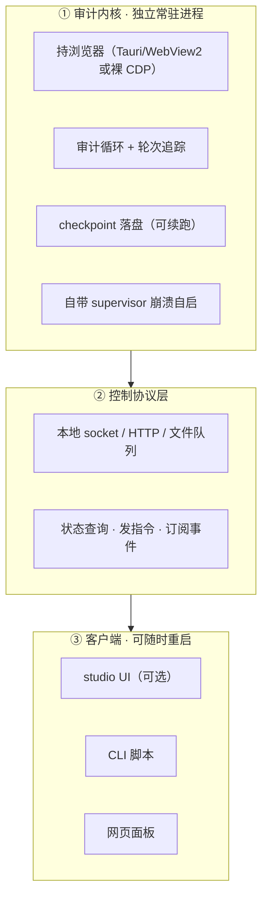

# 建议书 v0.2（修正版）：元宝审计与 studio 的进程解耦

> 版本：v0.2 · 2026-10-12
> 关系：**修正** `建议书-元宝插件架构升级-v0.1-20261012.md`
> 状态：v0.1 的「代码复用」结论仍有效；其「生命周期假设」被本文件推翻

---

## 0. 为什么出 v0.2

v0.1 主张「元宝 = studio 的第二个站点 profile」，解决了**代码复用**，但漏掉了**生命周期解耦**——两个不同维度被混为一谈。

评审意见（原文）：

> 不对劲。你说的 profile。那当前 studio 还在不断迭代。不断的需要重启。那元宝是属于要长期挂机的。这个架构不行吧。

**这条意见成立。** 本文件给出修正。

---

## 1. 矛盾陈述

| 维度 | studio 本体 | 元宝审计 |
|---|---|---|
| 生命周期 | 快速迭代，**随时重启** | **24h 挂机**，不能断 |
| 进程角色 | 前台 UI + 宿主 | 后台常驻任务 |
| 重启代价 | 无所谓（重新打开即可） | **丢失审计进度** |
| 迭代频率 | 高（cargo build / tauri:dev） | 低（跑起来就不动） |

**结论**：塞进同一进程 → studio 一重启，审计进程跟着死，`seen` 轮次集合 / baseline / 会话上下文全丢。

---

## 2. 调研证据（2026-10-12 实勘）

| 检查项 | 结果 | 含义 |
|---|---|---|
| 根目录 Cargo.toml | **不存在** | 非 workspace，单 crate；想加 crate 需先建 workspace |
| `sidecar.rs` | `RESTART_DELAY=2s`、`MAX_RESTARTS=5`、`probe_health()` | 有重启逻辑，但**是给 studio 的 host 用的**，非通用长任务监管 |
| `host/*.ts` 持久化 | 只有 `persistConfigPatch`（workspace/desktop-host）、`memory-store.persist` | **未发现「审计进度」级 checkpoint** |

**推论**：studio 目前**没有任何机制让一个长任务跨重启存活**。把审计放进去 = 自找麻烦。

---

## 3. 修正方案：三层解耦



### 3.1 与 v0.1 的差异

| | v0.1 profile 方案 | v0.2 修正方案 |
|---|---|---|
| 审计进程归属 | **studio 内** | **独立常驻** |
| studio 重启影响 | **审计中断** | **零影响** |
| studio 角色 | 必需宿主 | **可选 UI 客户端** |
| 进度恢复 | 无 | **checkpoint 续跑** |
| 能否不用 studio | 不能 | **能，CLI 直控** |

### 3.2 v0.1 中仍然有效的部分

- ✅ **代码复用结论**：`inject/sse-text-extractor.ts`(6150)、`inject/main-world-interceptor.ts`(40619)、`host/automation.ts`(12379) 等**作为库被引用**（或直接抄逻辑），不是运行时依赖
- ✅ **层级洞察**：DOM 层 → 协议层 的迁移方向
- ✅ **否决纯独立 / 改核心** 的论证
- ❌ **推翻**：元宝作为 studio 进程内的 profile

---

## 4. 关键设计：checkpoint

这是 24h 挂机的**命门**。

### 4.1 落盘格式

```json
// E:\NAS\ADM-auditkit\state\af-audit.checkpoint.json
{
  "project": "AF",
  "schema_version": 1,
  "seen_rounds": [6, 7, 8, "...", 42],
  "last_round": 42,
  "target": 100,
  "session_url": "https://yuanbao.tencent.com/chat/naQivTmsDa/...",
  "baseline_len": 26914,
  "updated_at": "2026-10-12T16:20:00+08:00"
}
```

### 4.2 写入时机

| 事件 | 动作 |
|---|---|
| 检测到新轮次 | 更新 `seen_rounds` + `last_round`，**同步写盘** |
| 每 30s 心跳 | 若状态有变则写，无变不写（减少 IO） |
| 收到 SIGTERM | 优雅收尾 + 写盘 |

### 4.3 恢复流程

```
启动 → 读 checkpoint
  ├─ 存在  → 校验 session_url 一致 → 从 last_round 续跑
  └─ 不存在 → 全新开始，建 baseline
```

**效果**：进程崩溃 → 重启 → 从第 42 轮继续，而不是从零。

---

## 5. 关键设计：自带 supervisor

不依赖 studio 的 `sidecar.rs`。审计内核自带：

| 能力 | 说明 |
|---|---|
| 崩溃退避重启 | 指数退避（2s→4s→8s…），上限后告警 |
| 心跳上报 | 每 30s 写 `state/heartbeat.json` |
| 卡死检测 | 心跳超 5min 未更新 → 外部看门狗重启 |
| 优雅退出 | SIGTERM/SIGINT 时写 checkpoint 再退 |

**注意**：`sidecar.rs` 的 `MAX_RESTARTS=5` 是针对短生命周期的 host 设计的，**不适合直接套用到 24h 长任务**（长任务应该无限重启 + 退避，而非 5 次后放弃）。

---

## 6. studio 的新用法

studio **仍要复用**，但换定位：

### 6.1 复用清单（作为库/骨架，非运行时依赖）

| 复用对象 | 方式 |
|---|---|
| `inject/sse-text-extractor.ts` | 直接引入或抄逻辑，解析元宝 SSE |
| `inject/main-world-interceptor.ts` | 参考其网络劫持写法 |
| `src-tauri/src/main.rs` | 照其骨架起**独立的** Tauri 窗口进程 |
| `host/automation.ts` | 参考审计循环模式 |
| `bridge/` 通信契约 | 若走 Tauri 则复用 |

### 6.2 不复用

- ❌ 不把审计进程挂进 studio 主进程
- ❌ 不依赖 studio 的 sidecar 监管
- ❌ 不让 studio 的重启影响审计

### 6.3 集成方式

studio 通过**控制协议**接入（读状态、发指令、订阅事件），本质是一个**可选的前端**。studio 崩了、重启了、升级了，审计内核照跑不误。

---

## 7. 修正后的路线

| 阶段 | 内容 | 交付物 |
|---|---|---|
| **Phase 0** | 承认矛盾，审计内核**独立立项**（不是 studio 的 profile） | 立项文档 |
| **Phase 1** | 内核：进程壳 + 浏览器 + 审计循环 + **checkpoint** | 可独立运行的审计内核 |
| **Phase 2** | 控制协议（socket/HTTP）+ CLI | 命令行可查状态、发指令 |
| **Phase 3** | studio 作为 UI 客户端接入 | 可选集成 |

**注意 Phase 顺序**：先把内核跑通、能独立活，再谈 studio 集成。v0.1 的错误就是把 Phase 3 的集成方式当成了 Phase 0 的立项方式。

---

## 8. 工作量对比

| 方案 | 估时 | 24h 存活能力 |
|---|---|---|
| v0.1 profile（studio 内） | 4.5 人天 | ❌ studio 重启即断 |
| **v0.2 解耦** | **6 人天**（多 1.5 天做 checkpoint + supervisor + 协议） | ✅ 独立存活 |
| 纯独立从头造 | 15+ 人天 | ✅ 但重造 90% |

**v0.2 仍比纯独立省 9 人天**——因为代码仍复用 studio 的，只是进程独立。

---

## 9. 请求决策（修订）

请开发团队就以下三点给出确认：

1. **是否接受「审计内核独立进程 + studio 可选 UI」的解耦定位**？
2. **是否同意 Phase 顺序**：内核先跑通（含 checkpoint），studio 集成放最后？
3. **代码复用边界**：`inject/` 与 `host/` 中哪些模块愿意被审计内核**作为库引用**（而非复制）？

---

## 10. 一句话结论

> **代码可以复用 studio 的，进程必须独立于 studio。**

审计内核要能脱离 studio 单独活、单独重启、单独恢复。studio 从「宿主」降级为「可选前端」。

---

## 附录：v0.1 → v0.2 变更摘要

| 章节 | v0.1 | v0.2 |
|---|---|---|
| 元宝定位 | studio 的第二个 profile | **独立进程 + studio 可选 UI** |
| 进程归属 | studio 内 | **独立** |
| 进度持久化 | 未涉及 | **checkpoint 落盘（新增）** |
| supervisor | 复用 studio sidecar | **自带（新增）** |
| Phase 顺序 | profile 化优先 | **内核独立优先** |
| 工作量 | 4.5 人天 | 6 人天 |

---

*本修正由评审意见触发，v0.1 的代码复用结论保留，生命周期假设推翻。*