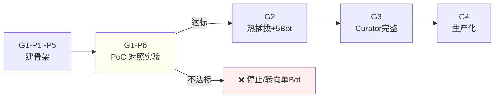

# Bot 功能完整计划书（v1.0）

> 日期：2026-10-14
> 基础：账号/槽位/人设三层解耦（#45）+ Curator 记忆治理（#46/#47）+ 场景判断框架（#48）
> 定位：deepseek-studio 从「单对话宿主」升级为「多 Bot 协作平台」

---

## 0. 一句话摘要

**Bot 的价值来自「多视角 + 并行 + 上下文隔离」，但它的最大风险也在这里——如果任务本不需要并行，引入多 Bot 只会增加协调开销。所以本计划书的第一原则不是「怎么做出多 Bot」，而是「先证明多 Bot 真的比单 Bot 划算」。**

---

## 1. 最大风险（按严重度排序）

### R1 ⭐⭐⭐⭐⭐ 价值证伪风险（最致命）

**风险**：多 Bot 的协调开销（委派、汇总、冲突消解、状态同步）**超过**它带来的并行收益，最终「5 个 Bot 不如 1 个 Bot 顺着做」。

**为什么最致命**：这是**架构级证伪**，不是 bug。如果 PoC 证明不了收益，整个项目不该继续。

**缓解**：
- PoC 必须**对照实验**：同一任务，单 Bot 串行 vs 多 Bot 并行，比总时长 + 质量
- 设**证伪门槛**：如果多 Bot 总耗时 < 单 Bot 的 60%，才继续

### R2 ⭐⭐⭐⭐ 账号稳定风险（外部不可控）

**风险**：网页版账号被风控、限流、封禁；标签页后台冻结（#7 元宝教训）。

**缓解**：
- 铁律 1 槽位 : 1 账号 : 1 窗口，绝不单账号多开
- 主 Bot 用 API（不占网页额度、无冻结）
- 账号健康检查 + 限流冷却 + 窗口前台化

### R3 ⭐⭐⭐⭐ 记忆污染风险

**风险**：错误记忆被多 Bot 复制成「虚假共识」；Curator 自己 drift；记忆跨人设泄漏。

**缓解**：署名制（谁写的、什么可信度）+ 人设标签路由 + 可回滚

### R4 ⭐⭐⭐ 汇总失真风险

**风险**：5 份报告汇总时，摘要丢失关键细节；冲突被错误消解；真 bug 被漏掉。

**缓解**：只回摘要但**保留证据引用**（指针，按需拉取全文）；冲突不自动裁决，标记待人工

### R5 ⭐⭐⭐ 成本失控风险

**风险**：多 Bot + Curator 治理 = 大量 token 调用，成本失控。

**缓解**：写路径零放大模型；治理批量/异步；每 Bot 有 tokenBudget；全局预算上限

---

## 2. 最难实现的卡点

| 卡点 | 难度 | 为什么难 |
|---|---|---|
| **C1 汇总的质量** | ⭐⭐⭐⭐⭐ | 「5 份摘要合成 1 份不丢信息」是**信息论难题**。压缩必然丢信息，关键在于「丢什么、留什么指针」 |
| **C2 冲突消解** | ⭐⭐⭐⭐⭐ | 两个 Bot 报矛盾事实，**没有 ground truth**。靠可信度层级裁决是启发式，不是真理 |
| **C3 账号窗口的生命周期管理** | ⭐⭐⭐⭐ | 网页版登录态会过期、会冻结、会限流；5 个窗口的协调是状态机地狱 |
| **C4 人设热插拔的干净卸载** | ⭐⭐⭐⭐ | 卸载人设时，槽位的上下文、记忆加载、工具视图都要干净回滚，否则人设串味 |
| **C5 成本与延迟的平衡** | ⭐⭐⭐ | 治理要及时（延迟低）就要频繁（成本高），反之亦然 |

**结论**：C1+C2 是**理论级难题**（无完美解，只能工程近似）；C3+C4 是**工程级难题**（能解，但要细致）；C5 是**调参问题**（能解）。

---

## 3. PoC 设定（关键一步）

### 3.1 PoC 目标

**回答一个问题**：多 Bot 并行审计，是否**显著优于**单 Bot 串行审计？

### 3.2 PoC 范围（最小）

- **2 个槽位**（不是 5 个）+ **1 个人设**（audit-expert）
- 同一目标（如 AutoForge），同一任务（找 bug）
- **对照组**：单 Bot 串行做同样的事

### 3.3 PoC 成功标准（量化）

| 指标 | 门槛 |
|---|---|
| 总耗时 | 多 Bot < 单 Bot 的 70% |
| 发现 bug 数 | 多 Bot ≥ 单 Bot |
| 误报率 | 多 Bot ≤ 单 Bot 的 1.2 倍 |
| 汇总报告可用性 | 人工评审「可直接使用」 |

**任一不达标 → 停止，回归单 Bot**。

### 3.4 PoC 不做什么

- 不做 5 Bot（先证明 2 Bot 有收益）
- 不做 Curator（先证明基础并行有收益）
- 不做人设热插拔（先用固定人设）

---

## 4. G1 实现什么（第一个可用版本）

### G1 定义

**可演示的 2 Bot 并行审计**，验证核心价值假设。

### G1 交付物

| 模块 | 内容 |
|---|---|
| `Account` 注册表 | 2 个网页账号 + 健康检查 |
| `Slot` 注册表 | 2 个槽位，绑定账号 |
| `Persona` 加载 | 1 个 audit-expert（prompt + tools + memory 目录） |
| `Scheduler.assign()` | 并行分发到 2 槽位 |
| `SubBotReport` 协议 | summary + findings + evidenceRefs + transcriptPath |
| 汇总槽 | 读 2 份摘要，去重合并，出报告 |
| 落盘 | `runs/<id>/<slot>.jsonl` 全文 + 汇总报告 |

### G1 不做什么

- 无 Curator（记忆治理推到 G2）
- 无热插拔（人设固定）
- 无 5 Bot（只 2 Bot）
- 无冲突消解（冲突只标记，不裁决）

### G1 验收

跑通一次真实审计，产出可用的汇总报告，且满足 3.3 的量化门槛。

---

## 5. 开发周期估算

> 前提：单人开发，复用 studio 已有 `ModelEngine`/`AgentLoop`/`ToolRegistry`/`toolEventBus`。

| 阶段 | 内容 | 工期 | 累计 |
|---|---|---|---|
| **G1-P1** | Account/Slot/Persona 三层数据结构 + 注册表 | 3 天 | 3 天 |
| **G1-P2** | `ApiEngine` 落地（当前是 stub）+ `SlotRuntime` | 5 天 | 8 天 |
| **G1-P3** | `Scheduler.assign()` 并行调度 + 账号健康检查 | 4 天 | 12 天 |
| **G1-P4** | `SubBotReport` 协议 + 落盘 | 3 天 | 15 天 |
| **G1-P5** | 汇总槽 merge 逻辑 | 4 天 | 19 天 |
| **G1-P6** | PoC 对照实验 + 调优 | 5 天 | **24 天** |
| **G2** | 人设热插拔 + 5 槽位 + 基础 Curator | 15 天 | 39 天 |
| **G3** | 完整 Curator（冲突消解/遗忘/路由）+ 稳定性硬化 | 20 天 | 59 天 |
| **G4** | UI 树 + 多平台适配 + 生产化 | 25 天 | 84 天 |

### 关键节点

- **第 24 天：G1 决策点**——PoC 达标则继续，不达标则停止或转向
- **第 39 天：G2 可用版**——人设热插拔 + 5 Bot
- **第 59 天：G3 稳定版**——记忆治理完整
- **第 84 天：G4 生产版**

### 诚实提醒

- 上述工期**不含调试意外**，实际可能 ×1.5
- **最大不确定性在 G1-P6**：PoC 可能证明价值假设不成立，此时**整个计划应停止**，而不是硬推 G2
- 网页版账号的稳定性问题（R2）可能反复消耗工期，建议 G1 就并行验证 API 路径

---

## 6. 里程碑与决策门

**决策门只有一个且必须硬**：G1-P6 的价值验证。**过不了就停，别沉没成本。**

---

## 7. 与已有讨论的呼应

| 本计划要点 | 来源 |
|---|---|
| 账号/槽位/人设三层解耦 | #45 |
| Curator 是治理层不是数据层 | #46 |
| 轻量写入+直接召回+阈值唤醒 | #47 |
| 场景判断：审计是最佳场景 | #48 |
| 1 槽位:1 账号:1 窗口铁律 | #39/#45 |
| 只回摘要+证据引用 | #40/#45 |
| 主 Bot 用 API | #13 |
| 窗口冻结需前台化 | #7 |

---

## 8. 一页决策

1. **最大风险是价值证伪**，不是技术——PoC 必须做对照实验，过不了就停。
2. **最难卡点是汇总质量与冲突消解**——理论级难题，只能工程近似。
3. **PoC 用 2 槽位 1 人设**，先证明「多 Bot > 单 Bot」，再谈 5 Bot。
4. **G1 = 可演示的 2 Bot 并行审计**，不含 Curator/热插拔/冲突消解。
5. **G1 约 24 天**，含 PoC 决策点；G2 再 15 天；完整版约 84 天（不含调试意外，实际 ×1.5）。
6. **唯一的硬决策门在第 24 天**：PoC 达标才继续。
