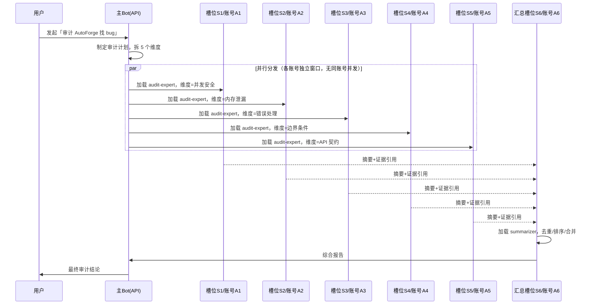

# 设计稿：Bot 编排 —— 账号/槽位/人设三层解耦（审计任务为范例）

> 来源：用户构想 —— 主 bot 主导审计计划并分发任务，5 个下属 bot 分不同维度审计，5 份报告交汇总 bot，
> 再回主 bot。每个 bot 对应一个 deepseek 网页版账号；**账号与人设记忆分离设计**：
> 执行审计任务就给 1 号槽位加载「审计专家人设 + 审计记忆」；执行开发任务就加载「开发专家 + 开发记忆」。
> 本文把该构想落成可实施架构。

---

## 0. 前提判定：这个方案为什么成立

| 风险点 | 判定 | 依据 |
|---|---|---|
| 5 个网页账号并行 = 封号？ | ✅ **不触发** | DeepSeek 风控盯的是「**同一账号**多窗口并发」。5 个**不同账号**各开 1 窗口，每账号仅 1 会话，不构成多开。 |
| 单账号开 5 窗口？ | ❌ **必封** | 这正是 cuckoo-code 的坑（记忆 #40）。本方案的前提是 **1 槽位 : 1 账号 : 1 窗口**。 |
| 主 bot 也是网页版？ | ⚠️ 建议 **主 bot 用 API** | 主 bot 要频繁调度、等结果、汇总，是长任务；用 API 稳定且不占网页额度。5 个下属用网页版。 |

---

## 1. 三层解耦模型（核心）

这是本设计的题眼。**账号、槽位、人设**是三个独立维度，两两可自由组合：

```
账号池 (Account)          槽位池 (Slot)            人设包 (Persona)
┌──────────────┐        ┌──────────────┐        ┌──────────────────┐
│ A1 网页账号1 │        │ S1 工作槽位  │        │ audit-expert     │
│ A2 网页账号2 │  ────▶ │ S2 工作槽位  │ ◀────  │   + audit 记忆    │
│ A3 网页账号3 │  绑定   │ ...          │  加载   │ dev-expert       │
│ A4 网页账号4 │        │ S5 工作槽位  │        │   + dev 记忆      │
│ A5 网页账号5 │        │ S6 汇总槽位  │        │ summarizer       │
└──────────────┘        └──────────────┘        └──────────────────┘
    凭证层                   执行层                    内容层
```

**一句话**：槽位是「工人的工位」，账号是「工人的工牌」，人设是「工人今天戴的帽子」。
换任务只换帽子（人设），不必换工位（槽位）和工牌（账号）。

---

## 2. 三层的职责边界

### 2.1 账号层 Account（凭证，长期稳定）

```ts
interface Account {
  id: string;              // A1..A5
  kind: 'web' | 'api';
  loginRef: string;        // 网页版：浏览器 profile 目录；API：keyRef
  status: 'ready' | 'rate-limited' | 'banned' | 'logged-out';
  cooldownUntil?: number;  // 限流冷却
}
```

- 账号**不绑定任务**，只绑定「一个浏览器 profile / 一份凭证」。
- 一个账号在任一时刻**只承载一个活跃会话**（这是防封号的铁律）。

### 2.2 槽位层 Slot（执行位，可复用）

```ts
interface Slot {
  id: string;              // S1..S5 工作槽 + S6 汇总槽
  accountId: string;       // 当前绑定的账号
  state: 'idle' | 'busy';
  currentRunId?: string;   // 正在跑哪个 run
  loadedPersona?: string;  // 当前加载的人设包名
}
```

- 槽位是「可复用的执行位」。任务结束→槽位回到 idle→可加载新人设接新任务。
- **槽位 → 账号**的绑定可配置：固定绑定（S1 永远用 A1）或动态分配（空闲槽位从账号池取）。

### 2.3 人设层 Persona（内容，可热插拔）

```
personas/
├── audit-expert/
│   ├── prompt.md          # 系统提示词（人设）
│   ├── tools.json         # 工具白名单
│   └── memory/            # ★ 该人设专属的持久记忆
│       ├── index.md       # 常驻上下文（根记忆）
│       ├── checklist.md   # 审计清单
│       └── past-bugs.md   # 历史发现
├── dev-expert/
│   ├── prompt.md
│   ├── tools.json
│   └── memory/
│       └── ...
└── summarizer/
    ├── prompt.md
    └── memory/
```

- 人设包 = 提示词 + 工具白名单 + **专属记忆目录**。
- **热插拔**：给槽位 S1 加载 `audit-expert`，跑完卸载，改加载 `dev-expert`，S1 的账号和窗口不动。
- 记忆随人设走：审计记忆不会污染开发任务。

---

## 3. 审计任务编排流程



**关键点**：
1. **并行是真的**——5 个不同账号，各开 1 窗口，互不干扰。
2. **汇总只收摘要**——否则 5 份全文直接撑爆汇总槽上下文（呼应 #40 的「只回摘要」）。
3. **人设统一**——5 个下属都加载 `audit-expert`，只是任务参数（维度）不同。

---

## 4. 数据流：只回摘要 + 证据引用

```ts
interface SubBotReport {
  slotId: string;
  dimension: string;
  summary: string;              // ★ 只回摘要（≤500 字）
  findings: Finding[];          // 结构化条目
  evidenceRefs: string[];       // 证据引用（文件:行号 / 日志路径），不内联全文
  transcriptPath: string;       // 全文落盘路径（供追溯，不进上下文）
}

interface Finding {
  id: string;
  severity: 'critical' | 'high' | 'medium' | 'low';
  title: string;
  location: string;             // 文件:行
  description: string;
  evidenceRef: string;
}
```

- **全文落盘**：`runs/<auditId>/<slotId>.jsonl`，可事后追溯。
- **进上下文的只有 summary + findings + evidenceRefs**，evidenceRefs 是「指针」不是内容。
- 汇总槽需要细节时，可按 evidenceRef **按需拉取**，而不是一次性灌入。

---

## 5. 人设热插拔的接口设计

```ts
interface SlotRuntime {
  slotId: string;
  /** 加载人设包（可热插拔） */
  loadPersona(personaName: string): Promise<void>;
  /** 卸载当前人设，槽位回 idle */
  unloadPersona(): Promise<void>;
  /** 以当前人设执行任务 */
  run(task: BotTask): Promise<SubBotReport>;
}

// 主 Bot 调度示例
await scheduler.assign({ slot: 'S1', persona: 'audit-expert', task: { dimension: '并发安全', target: 'E:/NAS/AutoForge' } });
await scheduler.assign({ slot: 'S2', persona: 'audit-expert', task: { dimension: '内存泄漏', target: 'E:/NAS/AutoForge' } });
// ...

// 换个任务类型：同一批槽位换人设
await scheduler.assign({ slot: 'S1', persona: 'dev-expert', task: { feature: '新增导出功能' } });
```

**S1 的账号 A1、浏览器窗口、登录态全程不变**，只是「换了顶帽子」。

---

## 6. 防封号与稳定性

| 机制 | 做法 |
|---|---|
| **1 槽位 : 1 账号 : 1 窗口** | 铁律，任何时刻同账号只有一个活跃会话 |
| **账号健康检查** | 定时探测登录态；`logged-out`/`banned` 立即摘除并告警 |
| **限流冷却** | 账号 `rate-limited` → 冷却 N 分钟，期间该槽位不派新任务 |
| **窗口前台化** | 网页版标签页被切后台会冻结渲染（记忆 #7 元宝教训）→ 需要时 `bring_to_front` |
| **主 Bot 用 API** | 主 Bot 是长任务调度者，API 无窗口冻结问题 |
| **崩溃隔离** | 单个下属 bot 失败只影响该槽位，主 Bot 收到 `{ok:false}` 继续 |
| **超时/预算** | 每个下属 bot 有 `timeoutMs` + `tokenBudget`，超支即中止 |

---

## 7. 与已有记忆的呼应

| 本设计点 | 呼应 |
|---|---|
| 只回摘要，全文落盘 | #40「子代理只回摘要」 |
| 不同账号 = 不触发封号 | #39「同账号多开才封号」 |
| 主 Bot 用 API / 下属用网页 | #13「能用 API 就用 API」 |
| 窗口冻结需前台化 | #7 元宝 watcher v4.2 教训 |
| 账号 ≠ Bot（账号是凭证容器） | #43「账号与 Bot 解耦」 |

---

## 8. 落地路线

| 阶段 | 内容 |
|---|---|
| **P1** | `Account` / `Slot` / `Persona` 三层数据结构 + 注册表 |
| **P2** | `SlotRuntime.loadPersona/unloadPersona`（热插拔核心） |
| **P3** | `Scheduler.assign()` 分配槽位 + 并行调度 |
| **P4** | `SubBotReport` 摘要协议 + 落盘 |
| **P5** | 汇总槽 merge 逻辑（去重/排序/证据链） |
| **P6** | 账号健康检查 + 限流冷却 + 崩溃隔离 |

**第一步最小可验证**：P1+P2 —— 定义 2 个账号、2 个槽位、1 个人设，跑通「给 S1 加载 audit-expert → 执行 → 卸载 → 换 dev-expert」，验证热插拔。

---

## 9. 一页决策

1. **三层解耦**：账号(凭证) / 槽位(执行位) / 人设(内容) 各自独立，两两可换。
2. **换任务只换人设**：槽位和账号不动，只加载/卸载人设包。
3. **1 槽位 : 1 账号 : 1 窗口**：防封号铁律，不同账号并行才安全。
4. **只回摘要 + 证据引用**：全文落盘，上下文只进指针，汇总槽按需拉取。
5. **主 Bot 用 API**：调度者要稳；下属用网页版拿免费额度。
